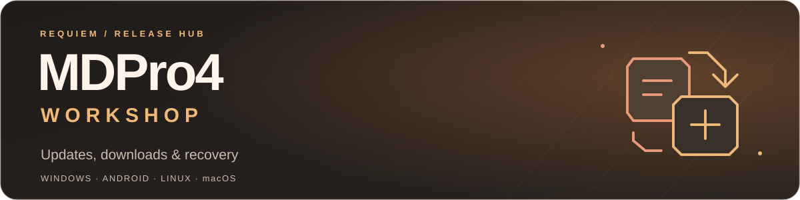

  

  <strong>The release hub for MDPro4, the community Yu-Gi-Oh! simulator.</strong> 
  Windows · Android · Linux · macOS

  <a href="#get-started">Get started</a> ·
  <a href="#update-your-game">Update your game</a> ·
  <a href="https://github.com/ElderLich/MDPro4-Workshop/releases/tag/v1.0.4">1.0.4 release notes</a> ·
  <a href="https://discord.gg/xh8jUCN9uq">Requiem community</a>

---

## Get started

**Installing for the first time?** Get the complete installer for your platform.
Visit the [MDPro4 / Requiem community](https://discord.gg/xh8jUCN9uq) for current
full-installer links, release announcements and installation help.

| Platform | What you need |
| --- | --- |
| **Windows** | The setup EXE and **all** accompanying payload parts, together in one folder. Run the setup EXE. |
| **Android** | The complete Android installation set. Follow its numbered APK-part instructions and let resource preparation finish. |
| **Linux** | The Linux setup wizard and all accompanying payload parts. Automatic updates require the full **1.0.2 base or later**. |
| **macOS** | The macOS setup wizard and all accompanying payload parts. Automatic updates require the full **1.0.2 base or later**. |

> [!IMPORTANT]
> The [Android APK attached to 1.0.4](https://github.com/ElderLich/MDPro4-Workshop/releases/tag/v1.0.4)
> updates the application. Existing installations also need the matching resource
> update offered in game. That APK alone is **not a complete first installation**.

MDPro4 has its own releases and Android application identity. Start with a full
MDPro4 installation when moving from MDPro3.

## Update your game

**Small patch steps start at 1.0.3.** Windows and Android 1.0.1 / 1.0.2 update
routes have been retired; use the full installation guidance above to move to a
current supported release. Keep your personal files and follow the package's
installation instructions. Do not apply a 1.0.0 patch to those versions.

Existing baseline installations still have one direct patch to 1.0.4:
**Windows/Android 1.0.0** and **Linux/macOS 1.0.2**.

1. Open MDPro4 and use the **in-game update check**.
2. Read the release notes and download the update offered for your installed version.
3. Let installation finish. On desktop, keep the game closed while the updater applies files.
   On Android, follow any APK installation prompt, reopen MDPro4 and allow resource preparation to complete.

The updater selects the compatible route and verifies its downloaded files.
A patch such as `1.0.0-to-1.0.4` updates that specific installed version; it is not
a standalone installer. Use the in-game route when catching up after skipped releases.
Some older installations update in stages: reopen the game and check again after
each completed step until it is up to date.

If a download is interrupted, reopen the updater and retry. Keep your existing
installation and personal files while troubleshooting.

## What's new in 1.0.4

- Rush Ritual monsters use the correct Ritual summon presentation.
- Deck Editor fixes overlapping card-edge selection and incorrect Genesys badges.
- Each deck can select a Duel Links field in its Appearance settings.
- Windows receives corrected update disk-space checks, alongside restored Solo Adventures content.

[Read the release details →](https://github.com/ElderLich/MDPro4-Workshop/releases/tag/v1.0.4)

## Need a recovery?

### Windows 1.0.3 / 1.0.3.1 — `FileVersionInfo`

1. Close MDPro4.
2. Download the [one-time updater recovery ZIP](https://updates.elderlich.com/patches/windows/MDPro4-windows-1.0.3-updater-recovery.zip).
3. Extract it beside `MDPro4.exe` and run `Repair-Windows-1.0.3-Updater.cmd`.
4. Reopen the game and run the normal update check.

If the repair says **Recovery is already configured**, fully close and reopen
the game before retrying. This recovery is for the affected Windows versions.

### Android 1.0.2 — `Dependency Exception` after updating

Read the [Android 1.0.2 recovery instructions](https://updates.elderlich.com/patches/android/README-android-1.0.2-recovery.txt),
then install the [recovery APK](https://updates.elderlich.com/patches/android/MDPro4-android-1.0.2-recovery.apk)
over the affected existing app and allow its resource
repair to finish. **Do not uninstall MDPro4 or clear its storage.** Working
installations and new players do not need this recovery package.
After repairing an affected 1.0.2 installation, follow the full installation
guide to move to a current release; its old incremental update route is retired.

## Get help

Join [MDPro4 / Requiem on Discord](https://discord.gg/xh8jUCN9uq) for installation
help and game feedback. For broken Workshop links or update-delivery problems,
[open an issue here](https://github.com/ElderLich/MDPro4-Workshop/issues).

Include your platform, installed version, the exact error and the step that
failed. A screenshot and the relevant log make the problem easier to reproduce.
On supported Android builds, shareable logs are in `Downloads/MDPro4`.

<strong>About this repository</strong>

Workshop hosts update catalogs, release information and Android application
update assets. Full offline installer sets are distributed through the
maintainer's mirrors; patch payloads are delivered by the update service.

Players can use the in-game updater without selecting a catalog manually.
Maintainers and tool authors can find catalog endpoints, compatibility rules and
the retained update policy in the [delivery documentation](docs/delivery.md).

