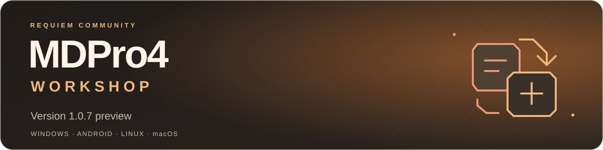

  

  <strong>The release hub for MDPro4, the community Yu-Gi-Oh! simulator.</strong> 
  Windows · Android · Linux · macOS

  <a href="#get-started">Get started</a> ·
  <a href="#update-your-game">Update your game</a> ·
  <a href="https://github.com/ElderLich/MDPro4-Workshop/releases/tag/v1.0.6">1.0.6 application release</a> ·
  <a href="https://discord.gg/xh8jUCN9uq">Requiem community</a>

---

## Get started

**Installing for the first time?** Get the complete installer for your platform.
Visit the [MDPro4 / Requiem community](https://discord.gg/xh8jUCN9uq) for current
full-installer links, release announcements and installation help.

| Platform | What you need |
| --- | --- |
| **Windows** | The setup EXE and **all** accompanying payload parts, together in one folder. Run the setup EXE. |
| **Android** | The complete Android installation set. Follow its numbered APK-part instructions and let resource preparation finish. |
| **Linux** | The Linux setup wizard and all accompanying payload parts. The supported original installation baseline is **1.0.2**. |
| **macOS** | The macOS setup wizard and all accompanying payload parts. The supported original installation baseline is **1.0.2**. |

> [!IMPORTANT]
> The [Android APK attached to 1.0.6](https://github.com/ElderLich/MDPro4-Workshop/releases/tag/v1.0.6)
> updates the application. Existing installations also need the matching resource
> update offered in game. That APK alone is **not a complete first installation**.

MDPro4 has its own releases and Android application identity. Start with a full
MDPro4 installation when moving from MDPro3.

## Update your game

The current release is **1.0.6**. Automatic updates retain these starting points:

| Your installation | Update route |
| --- | --- |
| Windows or Android **1.0.0** | One cumulative patch to **1.0.6**. |
| Linux or macOS **1.0.2** | One cumulative patch to **1.0.6**. |
| Any platform **1.0.4 or 1.0.5** | Follow **1.0.4 → 1.0.5 → 1.0.5.1 → 1.0.6**, starting at your installed version. |
| Any platform **1.0.5.1** | One patch to **1.0.6**. |
| An older intermediate version below **1.0.4**, other than the exact original baseline above | Install the complete package using the guidance above. Those older patch routes and the Windows 1.0.3 updater recovery are retired. |

Keep your personal files and follow the full package's installation instructions
when reinstalling. Do not apply a baseline patch to a different installed version.

1. Open MDPro4 and use the **in-game update check**.
2. Read the release notes and download the update offered for your installed version.
3. Let installation finish. On desktop, keep the game closed while the updater applies files.
   On Android, follow any APK installation prompt, reopen MDPro4 and allow resource preparation to complete.

The updater selects the compatible route and verifies its downloaded files.
A patch such as `1.0.0-to-1.0.6` updates that specific installed version; it is not
a standalone installer. Use the in-game route when catching up after skipped releases.
Windows can download its offered ordered patch chain together. Android, Linux
and macOS install one offered release per restart. Reopen the game and check
again after each completed step until it is up to date.

The **1.0.5.1** step updates resources while retaining the **1.0.5 application**.
The next **1.0.6** step includes the new player. Older Android application assets
can remain available when an offered intermediate step still needs them; use
the APK paired with your offered update.

If a download is interrupted, reopen the updater and retry. Keep your existing
installation and personal files while troubleshooting.

### Rebuilt Android and Linux 1.0.6

The rebuilt Android and Linux players keep version **1.0.6** and fix the
unsupported disk-space query that interrupted update preparation.

For Android with a pending 1.0.6 update or completed 1.0.6 resources, install the
current [1.0.6 application APK](https://github.com/ElderLich/MDPro4-Workshop/releases/tag/v1.0.6)
over the existing application. Do **not** uninstall it or clear its data. Reopen
the game and let resource preparation finish. A 1.0.5.1 installation without a
pending update should start the offered in-game update instead of installing
the APK alone. If a download started before the repair and reports a checksum
error, close and reopen the game and check for updates again. Preserve existing
pending-update files; a complete downloaded queue can finish with the rebuilt
APK. Contact support if the error persists instead of deleting update metadata
or personal data.

For Linux already running the original 1.0.6 player, install the existing full
1.0.2 baseline into a **new folder**, then use its baseline update to the rebuilt
1.0.6. A same-version player cannot receive a forward automatic patch. Retain
old decks, replays and settings until deliberately migrated; do not copy the
old player or entire `Data` folder over the new installation. No player-overlay
archive is required. Linux 1.0.5.1 uses the ordinary patch offered in game.

If an older Windows updater reports `PathTooLongException`, use a shorter
installation path, such as `C:\Games\MDPro4`, before retrying.

## What's new in 1.0.6

- **Endless Tower:** a separate Expedition mode with saved random floors, three lives, duel points and upgrade choices. Sanctuary runs retain their progress.
- **Progression improvements:** a redesigned Series dashboard, clearer room joining, reconnect fixes, rarity sorting and smoother pack selection and opening.
- **Combo Sheets from Test Hand:** create editable drafts from your opening hand, observed actions and last complete board, with compact groups and reusable cards.
- **Duel and replay fixes:** improved summon-material animations, a Duel Log that lists materials, Activation Order settings and corrected native card counters and placement guidance.
- **Native presentation updates:** restored Duel Links and Cross Duel effects, more cut-ins, Manga Frames, the riding stadium field and additional card-effect demonstrations.
- **Responsive layouts:** improved tablet, foldable and ultrawide views, including menus, the duel field, deck columns and pack openings.
- **Deck Sync improvements:** missing-file recovery, readable synced deck names and support for 600 deck identities per account.
- **Reliability improvements:** corrected Linux card-finish lighting, more resilient pre-release downloads, successful-update archive cleanup on Linux/macOS and release-player diagnostics.

Read the complete release notes in the in-game updater.

## Get help

Join [MDPro4 / Requiem on Discord](https://discord.gg/xh8jUCN9uq) for installation
help and game feedback. For broken Workshop links or update-delivery problems,
[open an issue here](https://github.com/ElderLich/MDPro4-Workshop/issues).

Include your platform, installed version, the exact error and the step that
failed. A screenshot and the relevant log make the problem easier to reproduce.
On supported Android builds, shareable logs are in `Downloads/MDPro4`.

<strong>About this repository</strong>

Workshop hosts update catalogs, release information and Android application
update assets. Full offline installer sets are distributed through the
maintainer's mirrors; patch payloads are delivered by the update service.

Players can use the in-game updater without selecting a catalog manually.
Maintainers and tool authors can find catalog endpoints, compatibility rules and
the retained update policy in the [delivery documentation](docs/delivery.md).

